> ## UPDATE — Web version is now the "City Grand Prix"
> Based on playtest feedback, `web/index.html` was rebuilt as **one single city circuit** (no separate levels): a closed 3.2 km loop through city streets, a long **bridge over water**, a **rough gravel road**, hairpins and a chicane. You race **7 AI opponents** over 2 laps with live positions, overtake bonuses, a **modern sports-car model**, a camera that looks into and leans with corners (4 camera modes), **turn-guide banner + coloured racing-line arrows**, a how-to-play guide, and a **results table plus high-score leaderboard** (saved in the browser).
> **Not yet updated:** the C++ desktop source, `docs/Project_Report.pdf` and `docs/Presentation.pptx` still describe the earlier four-difficulty version. Screenshots named `web_*` show the new version; `cpp_*` show the old C++ build.

# 3D Turbo Racer — CG Edition

A 3D racing game written in **modern C++17 and OpenGL**, with a built-in **Computer Graphics Learning Mode** that demonstrates the same maths the game runs on: translation, rotation, scaling, reflection, shearing, composite matrices, DDA, Bresenham, clipping, projection and animation.

**Author:** Sami Khan · [LinkedIn](https://www.linkedin.com/in/samikhan07) · [GitHub](https://github.com/samikhan7507)

| Desktop game (C++ / OpenGL) | Same game in the browser / phone (JS port) |
|---|---|
| 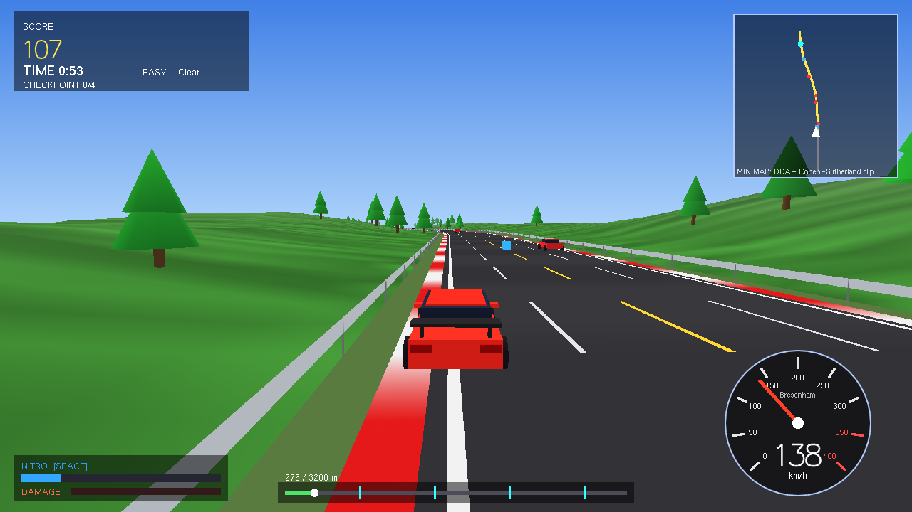 | 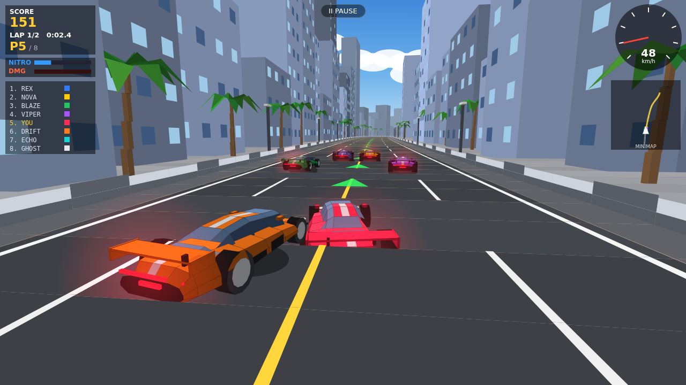 |

---

## Contents
1. [Features](#features) · 2. [Quick start](#quick-start) · 3. [Controls](#controls) · 4. [Difficulty levels](#difficulty-levels) · 5. [CG Learning Mode](#cg-learning-mode) · 6. [How the CG theory is used in the game](#how-the-cg-theory-is-used-in-the-game) · 7. [Online / phone version](#online--phone-version) · 8. [Project structure](#project-structure) · 9. [Testing](#testing) · 10. [Honest limitations](#honest-limitations) · 11. [Screenshots](#screenshots)

## Features
- **Track generator:** curved highways, sharp turns, hairpins, hills, mountain sections and rough terrain (bumps, gravel, drag, no guard rails).
- **Vehicle model:** speed-sensitive steering limited by tyre grip (bicycle model), slip/drift damping, handbrake, off-road slowdown, body roll and pitch.
- **Traffic, obstacles, collisions:** lane traffic including trucks, cones/barrels/rocks/barriers, oriented-box (SAT) collision detection, damage and wrecking, near-miss combos.
- **Nitro boost** with gauge, refill pickups, FOV "speed" effect and flames.
- **Scoring, checkpoints, timer:** checkpoint arches add time, finish bonus, stars, saved best scores.
- **Garage / upgrades:** Engine, Nitro tank, Tires, Handling (5 levels each), money earned per race, auto-saved.
- **4 difficulties**, each with its own environment and weather: Sunny highway, Rain + fog mountain pass, Night storm canyon (headlights, lightning), Snow blizzard.
- **CG Learning Mode:** 11 interactive pages with live formulas, live matrices, visual demos and "where is this used in the game" notes. Reachable from the main menu, the pause menu, or `L` during a race.
- **Cameras:** chase, far, hood. **Live CG overlay** (`G`) shows the model matrix and projection values used for the current frame.

## Quick start

### Linux (Ubuntu/Debian) — tested
```bash
sudo apt install build-essential cmake freeglut3-dev libglu1-mesa-dev
cmake -S . -B build -DCMAKE_BUILD_TYPE=Release
cmake --build build -j
./build/turbo_racer            # play
./build/selftest               # headless tests (no window needed)
```
No CMake? `make` builds `./turbo_racer` and `make test` runs the tests.

### Windows
Not tested by the author. Options: **MSYS2 MinGW** (`pacman -S mingw-w64-x86_64-freeglut mingw-w64-x86_64-cmake mingw-w64-x86_64-gcc`, then the CMake commands above), or Visual Studio + `vcpkg install freeglut`, then `cmake -DCMAKE_TOOLCHAIN_FILE=<vcpkg>/scripts/buildsystems/vcpkg.cmake`.

### macOS
Not tested by the author. `brew install cmake`, then the CMake commands above (CMake links Apple's built-in GLUT/OpenGL frameworks, which Apple has deprecated but still ships). The code avoids freeglut-only functions for this reason.

### No GPU / remote machine
`LIBGL_ALWAYS_SOFTWARE=1 xvfb-run -a ./build/turbo_racer --screenshots screenshots_out` runs a scripted autopilot demo and saves `.ppm` screenshots (this is how the screenshots in this repo were produced).

## Controls
| Key | Action | Key | Action |
|---|---|---|---|
| W / ↑ | Accelerate | SPACE | Nitro |
| S / ↓ | Brake / reverse | B | Handbrake (drift) |
| A D / ← → | Steer | C | Camera: chase / far / hood |
| G | CG maths overlay | L | CG Learning Mode |
| P / ESC | Pause | R | Restart |
| F | Fullscreen | | |

**Learning Mode:** `←/→` page · `TAB` select parameter · `↑/↓` change value · `P` auto-animate · `O` swap matrix order (Composite page) · `SPACE` restart animation · `R` reset · `ESC` back.

## Difficulty levels
| Level | Environment | Weather | Length | Grip | Notes |
|---|---|---|---|---|---|
| Easy | Sunny Coastal Highway | Clear | 3.2 km | 100 % | gentle curves, light traffic |
| Medium | Misty Mountain Pass | Rain + fog | 4.2 km | 88 % | hills, mountain walls and drops |
| Hard | Night Storm Canyon | Heavy rain, lightning, night | 5.2 km | 82 % | rough terrain, hairpins, rocks |
| Extreme | Arctic Blizzard Ridge | Snow blizzard | 6.0 km | 68 % | ice grip, dense traffic, tight clock |

## CG Learning Mode
| # | Page | Interactive demo | Formula shown |
|---|---|---|---|
| 1 | Translation | move the car; live 3×3 matrix | x' = x+tx, y' = y+ty |
| 2 | Rotation | angle + arbitrary pivot | x' = x cos a − y sin a … |
| 3 | Scaling | uniform / non-uniform | diag(sx, sy, 1) |
| 4 | Reflection | 5 mirror modes | diag(1,−1,1) … |
| 5 | Shearing | shx / shy with reference square | x' = x + shx·y |
| 6 | Composite | T·R·S vs S·R·T, ghosts of each step | M = T·R·S |
| 7 | DDA | pixel-by-pixel with xinc/yinc | steps = max(|dx|,|dy|) |
| 8 | Bresenham | decision parameter p_k per pixel | p0 = 2dy − dx |
| 9 | Clipping | Cohen–Sutherland outcodes, 9 regions | accept / reject / intersect |
| 10 | Projection | perspective vs orthographic, live P matrix | x_ndc = (f/a)·x/(−z) |
| 11 | Animation | 4 easing curves, graph, ghost trail | P(t) = P0 + (P1−P0)·e(t) |

## How the CG theory is used in the game
| Concept | Where it runs in the real game |
|---|---|
| Translation, rotation, scaling | `Mat4::translate · rotateY · rotateX` build every car/traffic model matrix (`main.cpp: drawCarModel`, `drawRace`) |
| Reflection | Left wheels and mirror = right ones drawn with `Mat4::reflectX()` |
| Shearing | Body/cabin roll in corners: `Mat4::shear(roll, …)` |
| Composite matrices | Model = T·Ry·Rx; MVP = P·V·M; minimap = T·S·R·T⁻¹ (`drawMinimap`) |
| Projection | `Mat4::perspective` with speed/nitro-dependent FOV, uploaded via `glLoadMatrixf` |
| DDA | Minimap road drawn with `ddaLine` |
| Bresenham | Speedometer needle and ticks with `bresenhamLine` |
| Clipping | Minimap segments clipped by `cohenSutherland` before drawing |
| Animation | `dt`-based camera easing, wheel spin, flame flicker, traffic; double-buffered loop |

Press **G** in a race to see these values live.

## Online / phone version
`web/index.html` is a single self-contained file (no build step, no dependencies) with the game, touch controls and the Learning Mode.

**Publish on GitHub Pages (free):**
1. Create a repo (e.g. `turbo-racer-cg`) under `samikhan7507` and push this folder to `main`.
2. In the repo: **Settings → Pages → Build and deployment → Source: GitHub Actions**.
3. The included workflow `.github/workflows/pages.yml` deploys `web/` on every push. The site appears at `https://samikhan7507.github.io/turbo-racer-cg/` (adjust to your repo name).

Alternative: **Settings → Pages → Deploy from a branch → `/web`** is not possible (only `/` or `/docs`), so either keep the workflow or copy `web/index.html` into `docs/` and select `/docs`. Netlify Drop / Cloudflare Pages also work by uploading the `web` folder.

> **Important:** the web version is a **JavaScript re-implementation** of the game (same physics constants, same track generator idea, own perspective projection on a 2D canvas). It is *not* the C++ code compiled to WebAssembly. The C++ / OpenGL desktop build is the primary implementation. See limitations.

## Project structure
```
TurboRacer/
├── src/
│   ├── main.cpp          rendering, HUD, menus, input, scripted screenshot mode
│   ├── game.hpp          game logic: track, physics, traffic, collisions, scoring, autopilot (no OpenGL)
│   ├── math3d.hpp        Mat3 / Mat4 / Vec maths written from scratch
│   ├── cg_algorithms.hpp DDA, Bresenham (two forms), Cohen–Sutherland
│   ├── learn_mode.hpp    CG Learning Mode (11 pages)
│   └── gfx.hpp           GLUT helpers (text, shapes, solids)
├── tests/selftest.cpp    35 headless checks + full-race simulation per difficulty
├── web/index.html        browser / phone port (GitHub Pages)
├── docs/                 Project_Report.pdf, Presentation.pptx, test results
├── screenshots/          real screenshots (desktop C++ and web)
├── .github/workflows/pages.yml
├── CMakeLists.txt · Makefile
```

## Testing
`./build/selftest` runs without a window and checks: matrix identities (R(30)R(45)=R(75), composite = sequential, non-commutativity, perspective near/far → NDC ±1, lookAt), Bresenham vs DDA agreement on 2000 random lines, textbook Bresenham vs general Bresenham, Cohen–Sutherland against brute-force sampling on 3000 random segments, collision/damage, nitro, upgrades, and an autopilot race on all four difficulties. Result: **35 / 35 checks pass** (`docs/test_results_cpp.txt`).
The full game (menus, 4 races, garage, 11 learning pages, results) was also run end-to-end in the scripted `--screenshots` mode. The web version was tested in headless Chromium (desktop and a 390×780 touch viewport) with zero JavaScript errors (`docs/test_results_web.txt`).

## Honest limitations
- **Platforms tested:** the C++ game was built and run only on **Linux (Ubuntu 24.04, g++ 13) using Mesa software rendering under Xvfb**. Windows and macOS instructions are standard but **untested**. Real-GPU frame rates were not measured.
- **Not tested by a human player on a real phone.** The web version was verified in Chromium with touch emulation only. Performance on low-end phones is unknown.
- **C++ does not run on phones.** Phones/browsers use the JS port, which differs from the C++ version: different random tracks, simpler car models, no mirrored-wheel reflection, no per-vertex lighting. The Learning Mode there is functionally equivalent but the C++ one is richer.
- **No audio** in either version.
- **Fixed-function OpenGL + GLUT** (legacy but simple and portable). Apple deprecates GLUT/OpenGL; it still compiles with warnings suppressed.
- **Balance is not human-playtested.** Difficulty/time limits were tuned with the built-in autopilot, which is cautious and cannot play like a person. In autopilot runs Easy is finished; higher levels are demanding (see `docs/test_results_*.txt`). Solid rocks near the road edge can pin a car — reverse with `S`.
- The C++ build has no gamepad support; the Learning Mode is keyboard-driven.
- Publishing to GitHub Pages must be done from your own account (the workflow is provided but has not been run).

## Screenshots
| | | |
|---|---|---|
| 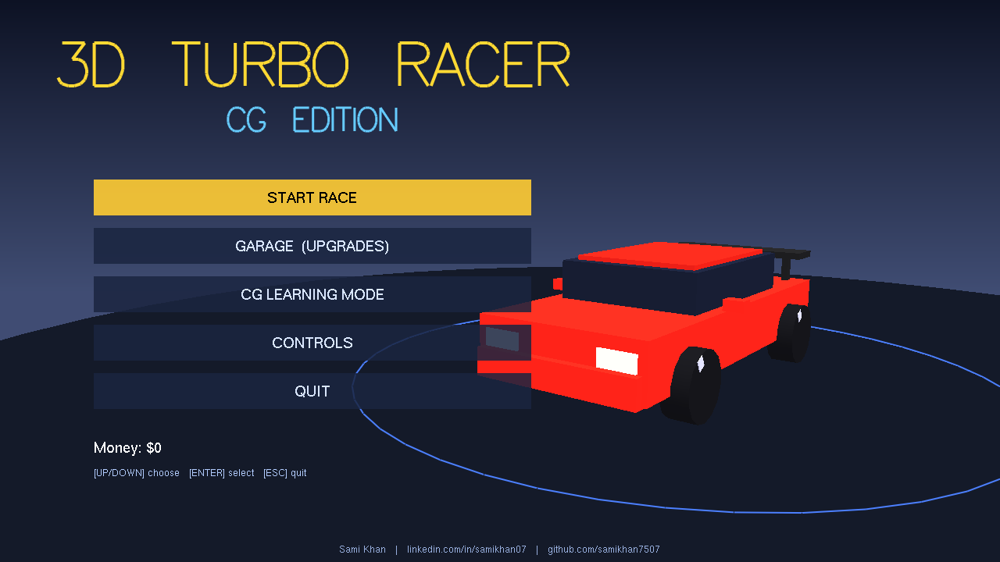 | 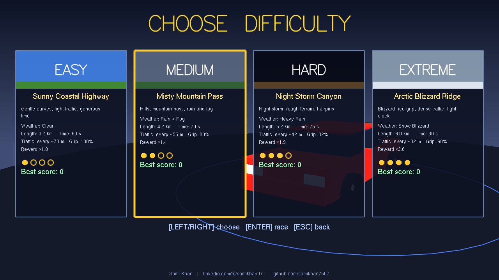 | 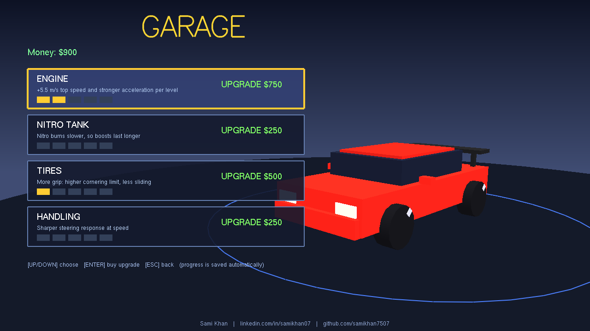 |
| 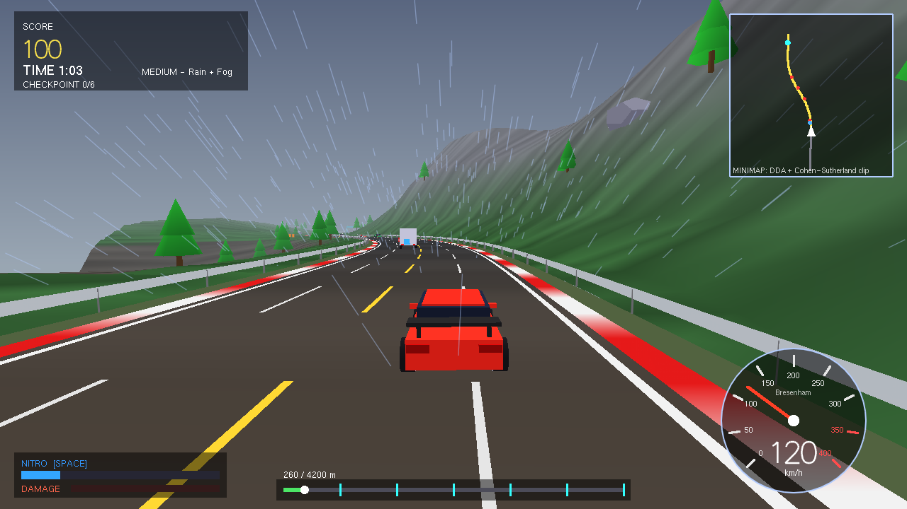 | 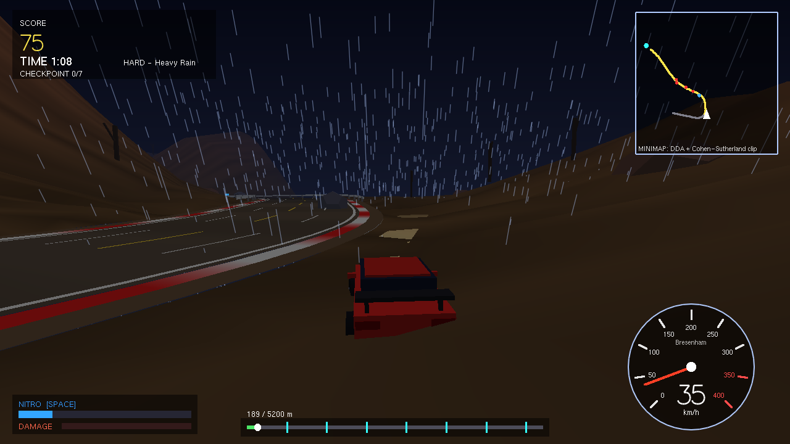 | 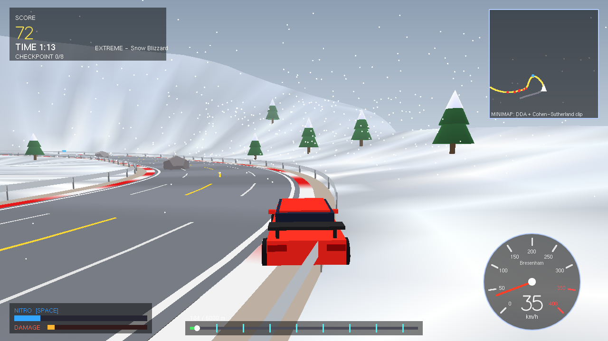 |
| 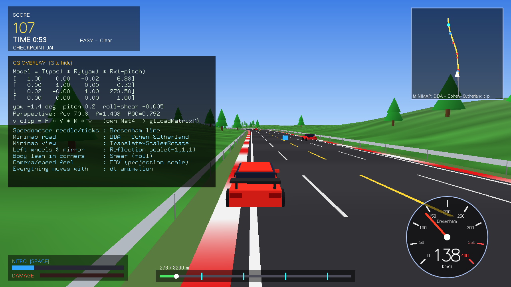 | 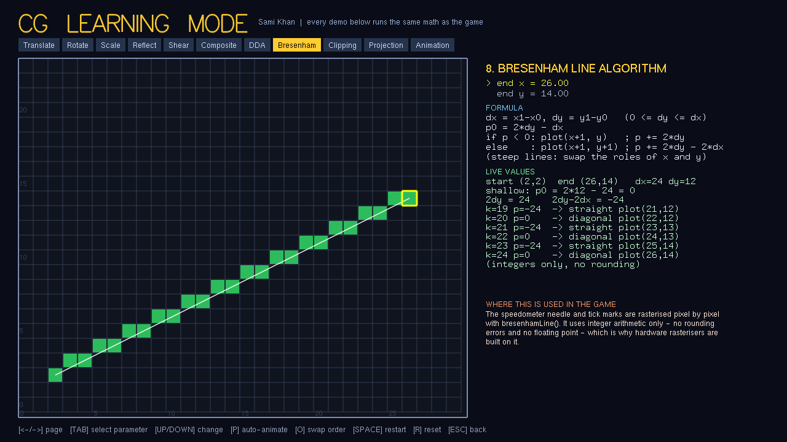 | 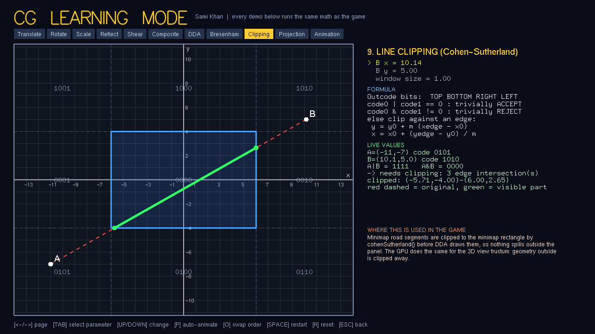 |
| 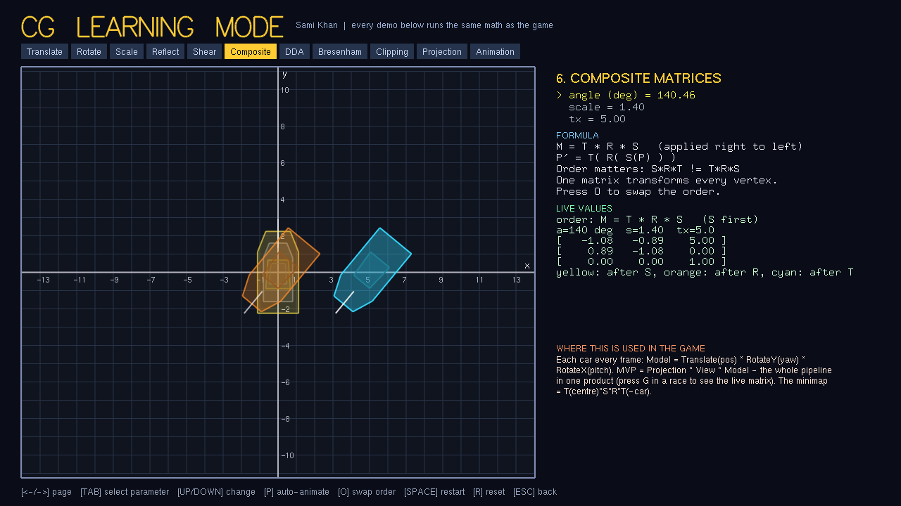 | 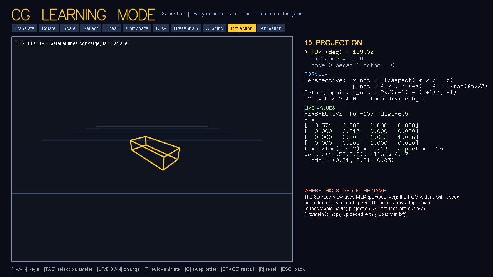 | 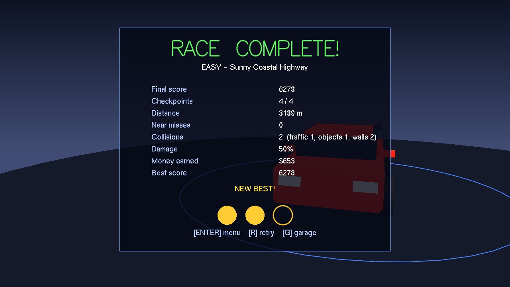 |
| 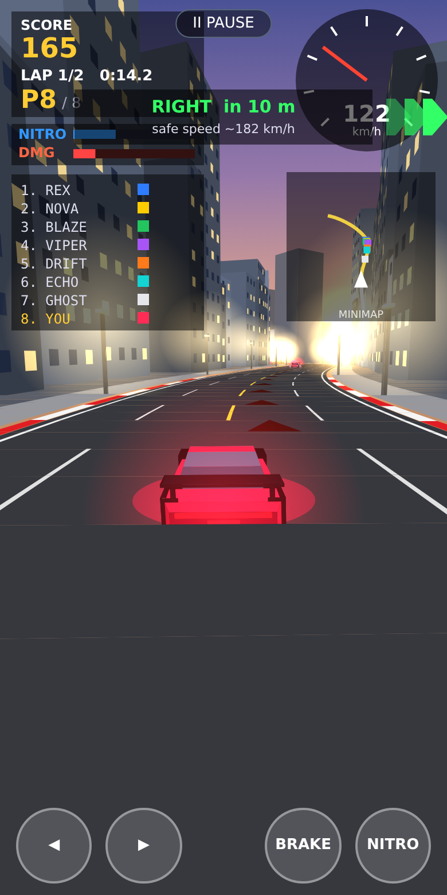 | 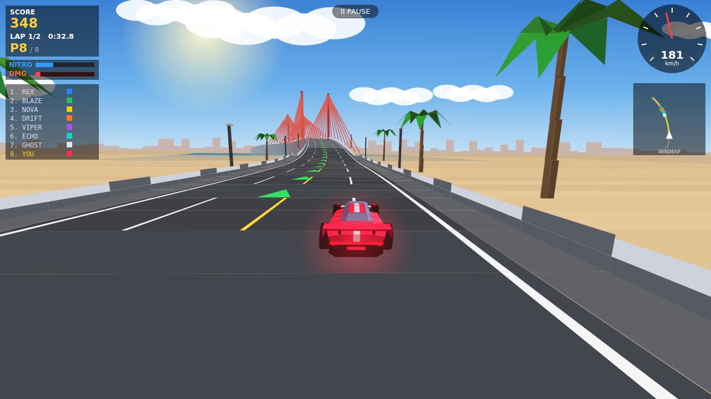 | 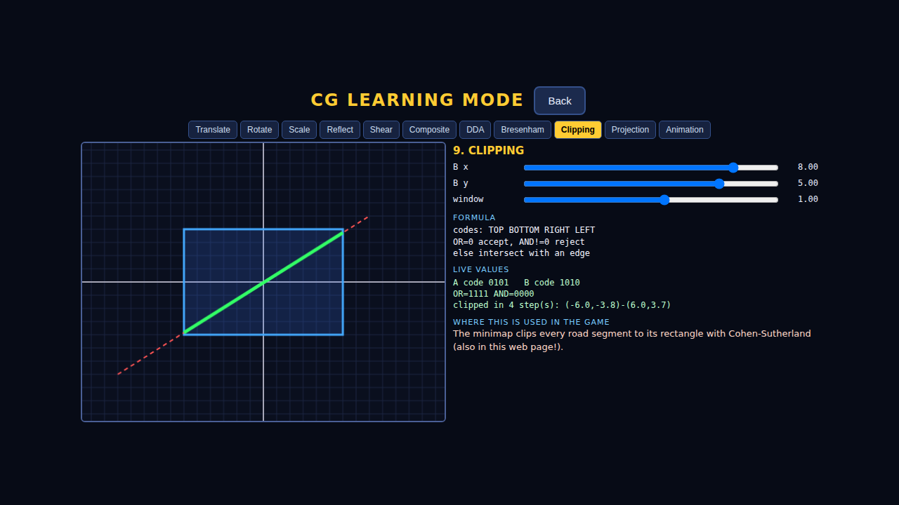 |

## License
Educational project by Sami Khan. Free to use for learning and academic submission; please keep the author credit.
